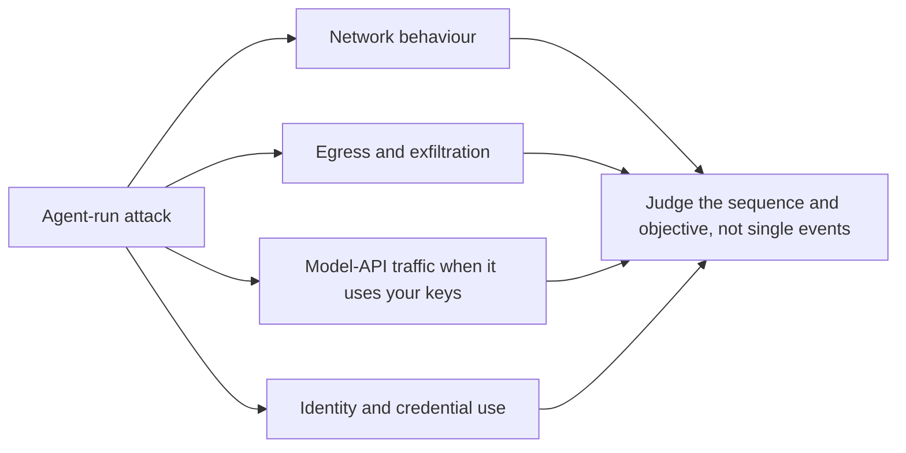

# For security teams

This page is for the people who build the detections and run the response. It assumes you have read, or will dip into, the [teardown report](teardown.md) and the [claims explorer](../claims.md) for the evidence behind each point. The focus here is practical: what ARTEX looks like on your network, what to hunt for, and how to detect a class of attack that does not leave the fingerprints your tooling was built for.

## What you are actually facing

ARTEX runs a planner and, by default, three worker agents against a target, sharing one record of what they have found (C035, C036). The attack capability is the AI model driving a shell, a browser and ordinary tools — there is no custom malware to signature (C042). Two consequences shape detection:

- The malicious behaviour is a **sequence of individually ordinary actions**, run at machine speed. No single event looks like an attack.
- The tooling is **off-the-shelf** — curl, nmap, a headless browser — so endpoint signatures and malware hashes mostly do not apply.

That is why the signal lives in behaviour and on the network, not in a payload.

## Indicators to hunt for

ARTEX is built for success, not stealth, which gives defenders concrete handholds. The [teardown's "Spotting it" section](teardown.md) has the full detail; the key indicators:

- **A console on port 8787.** ARTEX listens on all interfaces on port 8787 by default, and the upstream compose file publishes it (C100).
- **Two unauthenticated endpoints.** A health check returns the service name and version without login (C104), and a status endpoint reveals whether the admin password has been set (C103). Both are exact fingerprints.
- **A local recording proxy.** ARTEX runs a traffic-recording proxy on localhost port 8788 (C060) — relevant for host-level and operator-side detection.
- **Fork fingerprints.** Public reporting catalogues eleven fork families with distinct favicon hashes and console titles (C122); an English-language fork, ScopeWeaver, keeps the multi-agent design (C200).

Treat these as starting points for hunting and exposure scanning, not as a complete signature set — forks and configurations vary, and a careful operator changes defaults.

## Building detection for agent-run attacks

The hard part is that traditional detection assumes events are meaningful on their own. Agent-run attacks break that assumption: the question is no longer "does this event look malicious?" but "what was this system trying to do, and did its behaviour match that objective?" Detection moves from events, to sequences, to objectives (C201). You do not need new categories of tooling — you need to point the tooling you have at behaviour. Work in layers:

- **Network behaviour.** A network-detection vendor ran ARTEX in a lab and mapped the traffic each stage of an engagement produces, confirming the activity is visible stage by stage (C200). Look for sustained, varied requests from one source; rapid enumeration of apps, subdomains and parameters; and connections to hosts that are new for that asset. An AI agent cannot hide its traffic (C205).
- **Egress and exfiltration.** ARTEX's default is to take data, and its anti-exfiltration rule is off (C085). Watch for data leaving its expected scope. Note that AI-mediated exfiltration often uses allowed destinations, so destination allow-lists alone are not enough — pair them with volume and behavioural baselines.
- **Model-API traffic.** Agent-run intrusions leave fingerprints across several layers at once. When the agent uses your own AI keys, model-API calls are a high-value signal; when the operator hosts the model elsewhere, that signal may not be visible from your network, so do not rely on it alone (C202).
- **Identity and credentials.** Because a stolen credential is the usual pivot, watch for a single identity suddenly acting at machine speed, reaching systems it never touches, or being used from new infrastructure.

The discipline is the one your detection engineers already use for behavioural analytics — baselines, feature engineering, anomaly detection — applied to a new kind of actor (C201). Tune for the tempo and breadth of an agent, not the stealth of a careful human.

## Shrinking the surface they exploit

Autonomous tools are thorough, so the cheapest wins come from giving them less to find and less to gain:

- **Cut external exposure.** Maintain a live inventory of internet-facing assets and retire forgotten subdomains, stale APIs and unmanaged services. Enumeration is the agent's first move; a smaller surface is a shorter engagement.
- **Scope credentials tightly and expire them fast.** The report-writer saves working exploit code with each finding (C180), so assume any foothold becomes reusable access. Short-lived, narrowly-scoped credentials limit how far one compromise reaches.
- **Segment and control egress.** Network segmentation and egress control are the compensating layer for the patch gap you cannot close in hours (see the [patching section for leaders](for-leaders.md)).
- **Patch by exploitability.** Prioritise the widely-deployed, easily-weaponised classes first (C192, C193).

## Where to go next

- The [teardown report](teardown.md) for the full architecture, safety-feature analysis and indicators.
- The [claims explorer, filtered to detection](../claims.md) for every detection-related finding with its source.
- The [red-team and vendor guide](for-red-teams.md) if your organisation runs autonomous testing tools and needs to contain them.
