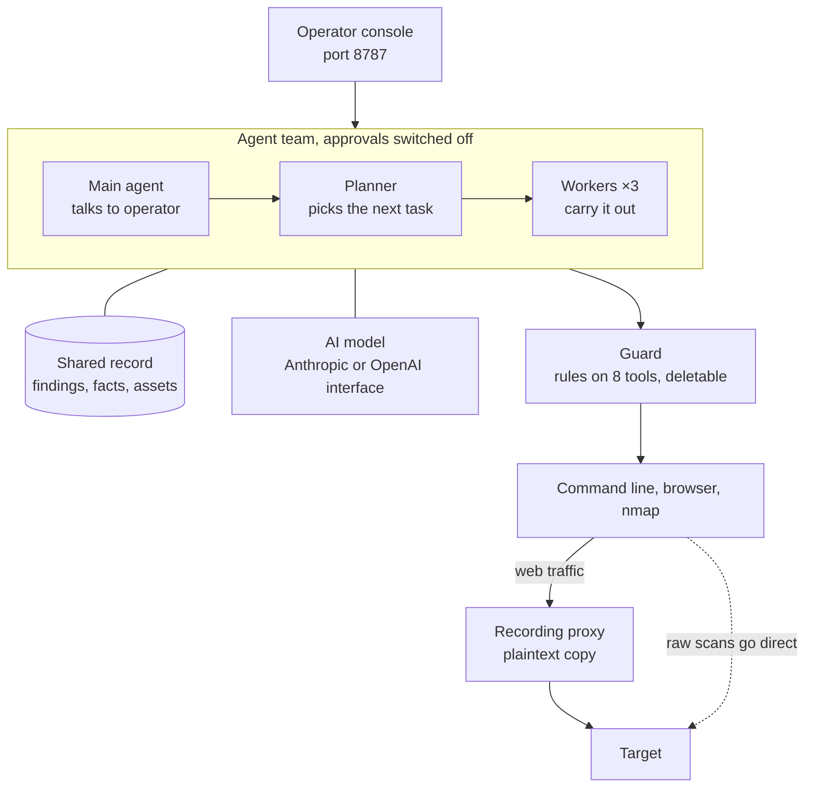

# ARTEX teardown: what the code says

<!--if-brand-->**Café Security Research**<!--/if-brand--><!--if-named:**{name}** · Café Security Research--> · Version 1.0, 22 November 2026

Part of the study [ARTEX: what the code says](../README.md). Every finding here is a numbered claim in [`claims.yaml`](../claims.yaml), with its evidence; the [methodology](../METHODOLOGY.md) explains how to check them yourself. Please cite as: <!--if-brand-->Café Security Research<!--/if-brand--><!--if-named:{cite}--> (2026). *ARTEX teardown: what the code says* (v1.0).<!--if-named: Café Security Research.-->

Current as of 22 November 2026. Tools, forks and reporting change quickly; re-check before relying on this.

ARTEX is the free, open-source AI hacking tool that the FBI warned about on 13 November 2026 [1]. This report is a review of its source code, written for **CISOs, business leaders and the security teams who defend their organisations**. The first two sections are a short briefing and an action list. The rest is the evidence: how it works, which safety features it has and what they leave out, how to spot it, and where each claim comes from.

Nothing was built, installed or run. The review read the code only. Every statement about the code points to a file and line, so anyone with the source can check it, and a script in this repository re-checks them all automatically. This report deliberately leaves out operating detail (prompts, settings for attacking, ways around defences); it covers what defenders need.

## Contents

- [The briefing](#the-briefing)
- [What to do](#what-to-do)
- [How it works](#how-it-works)
- [Its safety features, and what they leave out](#its-safety-features-and-what-they-leave-out)
- [Through two lenses](#through-two-lenses)
- [Spotting it](#spotting-it)
- [What public reporting says, checked against the code](#what-public-reporting-says-checked-against-the-code)
- [Limits of this review](#limits-of-this-review)
- [Appendix A: what was reviewed](#appendix-a-what-was-reviewed)
- [Appendix B: claims behind each finding](#appendix-b-claims-behind-each-finding)
- [Appendix C: sources](#appendix-c-sources)

## The briefing

**What it is.** ARTEX is a web console that runs a small team of AI agents against a target. A main agent talks to the operator, a planner decides what to try next, and workers (three at a time by default) carry it out. They share one record of everything found so far. It's built on a general-purpose AI agent engine, published under the same account, and works with any AI model that speaks the Anthropic or OpenAI interfaces.

**The capability is the AI model, not the code.** ARTEX contains no exploit library. Its own tools keep records (findings, assets, goals) and manage the platform. The agents attack using a command line, a web browser and standard security tools, and the AI model decides what to type. A better model makes ARTEX more capable without a line of its code changing.

**Its safety catch is off.** The engine it runs on has an approval step for risky actions. ARTEX switches it off for every agent. What's left is a small fixed floor in the engine that refuses four catastrophic commands, and ARTEX's own rules, which stop obvious damage (wiping disks, calling delete functions). The rule meant to stop data leaving ships switched off. By default it's built not to break the systems it attacks, and nothing in it stops it taking data from them.

**Its limits on scope are soft.** An operator can list what's in and out of bounds, and ARTEX blocks government and education domains by default. But those limits are checked only when the agents record a target or hand out work. The commands they actually run are never checked against them.

**It hasn't gone away.** The author withdrew the original on 8 October 2026 [9]. A surviving copy has 16 tagged releases since then, the latest dated 14 November. ReversingLabs counts 11 families of forks [4], and Censys counted 1,465 ARTEX consoles exposed on the internet in early November [2].

**Its users got attacked too.** A popular prebuilt copy carried a hidden backdoor that gave anyone who knew the trigger a shell inside the container. It was pulled about 9,000 times [3].

**What it means.** Nothing ARTEX does is new: it runs ordinary tools, quickly and without a human at the keyboard. What's new is that this costs almost nothing, runs unattended, and has its own brakes switched off. Your controls have to do the stopping. Don't count on the attacker's tool to stop itself.

## What to do

### For CISOs and business leaders

1. **Assume you're being tested without permission.** Agent-driven probing is now background noise on the internet. The useful question is whether anyone would notice, and how quickly.
2. **Make data leaving the hard part.** ARTEX's defaults avoid damage but don't stop data leaving. Egress controls, data-loss controls and monitoring of who reads sensitive data now matter as much as keeping attackers out.
3. **Fix the basics first.** Public cases start with exposed services, leaked or long-lived keys and weak sign-in [5][6]. Those are the cheapest doors for an AI agent to find.
4. **Make speed visible.** An agent works far faster than a person. Alert on sessions moving at machine speed, and let automation answer them.
5. **If you commission AI-driven testing,** ask the supplier how its tool is controlled: which approvals are on, how scope is enforced at the network, where recorded traffic is kept. ARTEX shows these can't be assumed.

### For security teams

- **Hunt for consoles** using the fingerprints in [Spotting it](#spotting-it), but expect forks to change branding.
- **Detect behaviour, not the tool.** The AI writes the commands, so the indicators change from run to run [7]. Alert on what the activity does.
- **Expect blocks to cause retries, not stops.** The workers' own instructions say a first block (a filtered request, a 404) doesn't mean a route is exhausted, and to try every way round it before concluding (`agent/worker.go:234`). A code comment says the same of the agent's instinct (`guard/guard.go:126-137`). A WAF slows it; it won't stop it.
- **Watch cloud logs for stolen keys in use.** Datadog saw ARTEX searching cloud logs for secrets with compromised keys, and abusing public sign-up pools [5].
- **Plant tripwires.** The agents hunt for credentials [5][6]. Decoy keys and canary tokens that nothing legitimate uses give high-confidence alerts.
- **Look for the tools it brings:** raw port scans, headless Chromium, command-line HTTP clients, and harvesting of a web app's API endpoints.

### If your team runs ARTEX or a fork for authorised testing

- **Build from reviewed source; never pull prebuilt images.** Anyone who used the backdoored images should treat that deployment as fully compromised and rebuild it [3].
- **Keep the console off the internet, and set the admin password before it's reachable.** Whoever first opens a new console sets the only admin password (`server/auth.go:157-158`, `123`).
- **Turn on the safety rules that ship off:** the data-exfiltration rule, per-task allowlists, human approval ("ask") for risky actions.
- **Enforce scope in the network, not in the tool.** ARTEX's scope checks don't cover the commands its agents run, so a firewall or egress allowlist is the real boundary.
- **Treat console access as full control of the host.** Custom tools and plugin servers run any code by design, and the built-in "auto" agent can create new ones (`server/platform_tools.go:15-16`).
- **Keep secrets out of the process environment.** Every command the agents run inherits ARTEX's environment, and the default setups put the model API keys and the database password there (upstream `docker-compose.yml:23-26`; engine `tool/task.go:140-145`). The model can read them, and so could a target that manages to steer it (see [Limits](#limits-of-this-review)).
- **Handle the recordings as sensitive data.** ARTEX keeps a full, unredacted copy of the web traffic it exchanges with targets.

## How it works

### The pieces

| Piece | What it does | Reference |
| --- | --- | --- |
| Engine | `Autumn-27/norma` v0.4.3, published under the same account as ARTEX. Its README calls it a general-purpose agent SDK that doesn't know whether it's driving "a coding agent, a security auditor, or a customer-support bot". It provides the agent loop, the command-line, file and web tools, approvals, hooks, plugins, skills and memory management. Reviewed too; see [The engine underneath](#the-engine-underneath). | `go.mod:6`, `go.sum:1-2`; engine `README.md` |
| Console | Web console and API, listening on all network interfaces on port 8787 by default. | `cmd/artex/main.go:55` |
| Shared record | A database of findings, facts, assets and planned work that all agents read and write. | `db/` |
| Model connection | Anthropic (the default), OpenAI or any OpenAI-compatible service. Optional failover to backup model accounts when one runs out of credit or is revoked; off by default. | `agent/provider.go:153-250`, `llmpool/health.go:1-9`, `server/manager.go:515` |
| Recording proxy | Copies every web request and response between the tools and the target, in full and unredacted. On by default, listening only locally. | `traffic/traffic.go:1-4`, `cmd/artex/main.go:57` |
| Notifications | Sends findings to Telegram, email, webhooks and three workplace chat apps (DingTalk, Feishu, WeCom). | `notify/` |
| Reports | Builds a Markdown report from the shared record and keeps evidence for each finding. | `report/`, `evidence/` |
| Size | About 59,300 lines of Go in 174 files (plus about 28,100 lines of tests) and a web console of about 52,800 lines of TypeScript; the engine adds about 18,800 lines of Go. Counts are non-blank lines at v0.3.15. Its built-in agent instructions are written in Chinese, as are some code comments. | C216, C217 |

### The agents

| Agent | Job | Shell | Default time limit | Reference |
| --- | --- | --- | --- | --- |
| Goals | Splits the operator's goal into sub-goals and records the operator's constraints | No: goal and scope tools only | None per run | `agent/goals.go:133-138` |
| Planner | Reads the shared record, hands out work, stops or redirects it, decides when a goal is met | Yes, interactive too | None per run | `agent/planner.go:375`, `db/db.go:250` |
| Main agent | Turns the operator's messages into hints and urgent tasks | Yes, interactive too | None per run | `agent/mainagent.go:127`, `db/db.go:250` |
| Workers (3 at a time) | Carry out one task each, record what they find, then stop | Yes, interactive too | 20 minutes per run | `server/manager.go:283-284`, `agent/worker.go:379`, `server/task_llm.go:570` |
| Auto | Manages the platform: starts tasks, and creates skills, custom tools and plugins | Yes, interactive too | 20 minutes per run | `server/platform_tools.go:15-16, 30` |
| Pentest | A single agent that runs a whole attack chain by itself | Yes, interactive too | None | `db/db.go` (`builtinAgents`, pentest entry) |

Turns are unlimited by default (`agent/mainagent.go:27`). A whole task has no time limit unless the operator sets one (`db/tasks.go:42`). The latest release checked (v0.3.30) adds an asset-mapping agent.

### Tools and skills

- **Every acting agent gets a command line.** The planner and main agent get the engine's full default tool set; workers get it minus three search and edit tools (`agent/mainagent.go:127`, `agent/planner.go:375`, `agent/worker.go:379`). Interactive shells are switched on by default for planner, workers, main agent, auto and pentest (`db/db.go:250`).
- **The standard image brings the tools.** It installs nmap, netcat and other network tools plus Playwright and Chromium, and runs as root (`Dockerfile:17-30`, no `USER` line). The browser packages are pulled at `@latest`, unpinned.
- **Skills are mostly off by default.** Of the three bundled skills, only API endpoint discovery is visible by default. Browser automation and a scanning-platform plugin must be switched on, and the browser plugin ships disabled (`db/db.go`, `builtinSkillVisibility` and the browser MCP seed).
- **It can extend itself.** The auto agent can create skills, custom tools (command, HTTP, script or shell) and plugin servers (`server/platform_tools.go:15-16`; tool kinds in `server/customtool.go`).
- **Web search** uses DuckDuckGo by default, or Brave, Tavily or DeepSeek (`server/manager.go:278-282`).

### What it records

- **Web traffic, in full.** Commands are given the recording proxy's settings and its certificate, and the browser is pointed at it, so their web traffic is copied in plaintext (`agent/worker.go:197-211`, `server/manager.go:637-664`). Raw network scans don't use web proxies and bypass it.
- **AI conversations, if switched on.** An optional setting stores every prompt and model response in the database; off by default (`server/manager.go:414`).
- **An optional outbound proxy,** empty by default, can send all target traffic through a server of the operator's choosing (`server/manager.go:243-247, 434-439`).

A background engine for automatically looking up and probing every recorded asset exists and starts four workers (`server/manager.go:442`), but nothing in v0.3.15 or v0.3.30 ever sends it work. It's dormant.

### The engine underneath

ARTEX's agents run on `norma` v0.4.3. We fetched its public `v0.4.3` tag and computed Go's module hash over it; it matches the hash ARTEX pins exactly (`h1:DnmOhJPL…`, ARTEX `go.sum:1`), so this is the code ARTEX builds against. ARTEX uses its tool, model, transcript, permission, session, loop, skill, compression, plugin and hook packages. Line references below are for norma v0.4.3 (commit `320ae329`).

- **It isn't a hacking tool.** It's a general agent framework with a standard toolset: read, write and edit files, list and search them, run shell commands, and optional web fetch and search (engine `README.md`). The attack capability comes from what ARTEX gives the model to do with those tools.
- **Approvals come before hooks.** For each tool call the engine checks approvals first, then runs the host's pre-tool hooks (`harness/tools.go:57-83`). ARTEX's bypass mode allows everything except tools named in a deny rule (`permission/permission.go`, `Evaluate`), and ARTEX sets no deny rules. So ARTEX's own guard, which is a hook, still runs after the bypass. It's the only gate.
- **A small fixed floor survives bypass.** The shell tool refuses four catastrophic commands in any mode: deleting the root filesystem, a fork bomb, formatting a device and overwriting a disk (`tool/bash.go:17-25, 61-71`). It can't be switched off. The interactive shell tools have no such floor; they always allow (`tool/shell_tools.go:23-33`).
- **Commands get two minutes by default, ten at most,** and long ones can be moved to the background (`tool/bash.go:86-99`).
- **Commands inherit the whole environment** of the ARTEX process (`tool/task.go:140-145`). Plugin servers do too (`mcp/stdio.go:33-37`).
- **Web fetch has no block on internal addresses.** It asks for approval in normal mode; under ARTEX's bypass it's allowed (`tool/webfetch.go:57-62`).
- **No phoning home.** The engine's only built-in hosts are model providers and search services.
- **No defence against prompt injection.** The engine doesn't mark tool output as untrusted; only one example app's prompt mentions it (`examples/coding-agent/prompt.go:17`).
- **No licence file** in v0.4.3, unlike ARTEX (AGPL-3.0).

## Its safety features, and what they leave out

| Feature | Default | What it covers | What it leaves out | Reference |
| --- | --- | --- | --- | --- |
| Engine approvals | **Bypassed for every agent**; no deny rules set | Nothing | Everything | `agent/mainagent.go:142`, `planner.go:412`, `worker.go:436`, `chat.go:134`, `goals.go:157`; engine `permission/permission.go` |
| Engine safety floor | On; can't be switched off | Four catastrophic commands in the shell tool | Everything else; commands sent through interactive shells | Engine `tool/bash.go:17-25, 61-71`, `tool/shell_tools.go:23-33` |
| ARTEX's own tools | Always allowed | n/a | Their permission checks return "allowed" unconditionally | `server/orchestration.go:125-127, 137-139`, `server/customtool.go:289-291` |
| Scope instructions | Text in the agents' prompts | What the model chooses to follow | Anything the model ignores; nothing enforces it | `agent/constraints.go` |
| Asset gate | On, with a built-in blocklist | Recording assets; handing out work tied to recorded assets | The commands agents run; work with no asset attached. Skipped when recording if the rules can't be read. | `db/asset_intercept_match.go:175-196`, `agent/tools_insert.go:230-250`, `agent/tools.go:1052-1064` |
| Built-in blocklist | On | Government and education domains (`.gov`, `.edu` and two country-specific equivalents) | Everything else; the rows can be deleted | `db/db.go:288-314` |
| Tool rules: destructive commands | On | Wiping disks, formatting, shutting down, deleting through web interfaces | Rules can be switched off or deleted | `db/db.go`, `seedDefaultInterceptRulesV1-V3` |
| Tool rules: data exfiltration | **Off** | Piping output to another host, once switched on | Everything, by default | `db/db.go:568` |
| Which tools the rules see | 8 named tools | Command line, interactive shell, file writes, web fetch, web search | Browser automation, plugins, custom tools | `intercept/intercept.go:141-147` |
| Human approval | Off unless a rule asks | Calls matching an "ask" rule | Everything else | `guard/guard.go:110-121` |
| AI judge for unmatched calls | Off | Calls no rule matched, once switched on | Everything, by default | `intercept/intercept.go:338` |
| Audit log | On | The last 2,000 tool calls, in memory; rule hits saved to the database | Older calls; anything after a restart | `guard/guard.go:104-108, 181-188` |
| Old scope mechanism | Removed | n/a | The code says a replacement "may be added later" | `guard/guard.go:4-5` |

Two details matter for defenders:

- **ARTEX labels its own blocks** as platform policy, "not target defence", so the agent doesn't try to get round them. The comment explaining why says a bare block looks just like a target's WAF, and the agent's instinct then is to rewrite, re-encode and retry (`guard/guard.go:126-141`).
- **A tally of "blocked" results** (403, WAF, rate limit, CAPTCHA and similar) is kept, with a comment saying it lets the planner change strategy. In the reviewed code the tally only reaches the audit screen, not the planner (`guard/guard.go:143-163`, `server/server.go:3870`).
- **Escaped commands.** The v0.3.30 changelog says the rules now also match decoded strings, fixing dangerous commands that newlines, tabs or escaped quotes let past the rules in earlier versions (`CHANGELOG.md:16` in v0.3.30). We didn't test the earlier behaviour.

## Through two lenses

**Feed, Behaviour, Impact,** the author's framework for AI risk [12]. What it reads (Feed): web pages, server responses and search results from the target, all of it untrusted. What decides (Behaviour): an AI model, with the approval step switched off. What it can do (Impact): anything a root command line, a browser and the network can reach.

**Meta's Agents Rule of Two** [11] says that, until prompt injection can be reliably detected, an agent should combine at most two of: untrusted input, sensitive data, and the ability to change things or communicate externally. ARTEX has all three by design; that's what an attack tool is. So the only dependable limits are outside it, in the defender's network, identity and data controls. The same holds for teams running it legitimately. Their agents read attacker-controlled content while holding the operator's own keys (C106), so they should put the boundaries in their own infrastructure.

## Spotting it

### Console fingerprints

| Signal | Value | Source | Caveat |
| --- | --- | --- | --- |
| Port | 8787, all interfaces by default | `cmd/artex/main.go:55`; most exposed consoles use it [8] | Configurable; the FailSafe build binds to local only |
| Health check | `GET /api/health` needs no login and returns JSON with `"service":"artex"` and the version | `server/server.go:948`, `server/auth.go:123` | Forks can change it |
| Login status | `GET /api/auth/status` needs no login and says whether the admin password is set | `server/auth.go:140-154`, `123` | A console reporting "not set" can be taken over by its first visitor |
| Favicon hash (mmh3) | `-576220750` for the original; AntiFox fork `-1356779733` and `-397770841` | [4] | Rebrands change it |
| Favicon SHA-256 | `8b567c0244f2dbee787165aea9c4ddabaaafb0fdb3b29899ac898c60a589856b` (original) | [4] | Rebrands change it |
| Page title | The original uses a fixed ARTEX-branded title [5]; forks use generic titles such as "401 Authorization Required", and one imitates a Google sign-in page [4] | [4][5] | Titles are easy to change |
| Sessions | One admin password; no login throttling found; sign-in tokens last 7 days | `server/auth.go:22` | Applies to v0.3.15 |
| Agent control endpoint | `/mcp` lets outside agents view, create, pause and steer tasks, with its own access tokens | v0.3.30 `CHANGELOG.md:11` | New in v0.3.30; off by default |

Around one in ten exposed consoles also hosted other attack tooling, such as Cobalt Strike [2]. ReversingLabs consolidated 3,147 IP indicators from vendor reporting and its own searches [4]; use them for hunting, not as proof.

### Behaviour on your side

- Raw port scans and command-line web clients, at machine speed.
- Headless Chromium sessions, when browser automation is switched on.
- Mapping of a web application's API endpoints, then requests to each.
- Rewritten and re-encoded retries after a block (`agent/worker.go:234`, `guard/guard.go:126-137`).
- In cloud environments: stolen long-lived keys used to search logs for more secrets, and abuse of public sign-up pools [5].
- Some activity is detectable even when the agent fails its goal [10].
- Tool names in web requests, in older builds only. Requests from earlier versions could carry `norma/0.4` (the engine's web fetch) or `artex-enrich/1.0` [13][15]. From v0.3.30 ARTEX sends ordinary browser user agents and its agents are told to copy the target's own headers (`internal/httpidentity/useragent.go`, `agent/prompt.go:24`), so use these names to search old logs, not as live signatures.

Detection engineers' consistent advice is to watch behaviour, because the model writes different commands each run [7][9].

## What public reporting says, checked against the code

| Public claim | Source | What the code shows |
| --- | --- | --- |
| A team of agents: planner, workers, verification and compression, sharing a knowledge graph | Amazon [6] | Planner, workers and a shared record confirmed; memory compression is built into the engine. Neither version checked has a separate verification agent; goal checking is a planner tool. Amazon may have seen a fork. |
| ARTEX is a harness around an AI model | MalwareMustDie [7] | Confirmed: no exploit library; capability comes from the model, the command line and standard tools. |
| Consoles found on default port 8787 | SOC Prime, citing Censys [8] | Confirmed: default listen address `:8787` on all interfaces. |
| The backdoor was in prebuilt images, not the source | CSA [3]; FailSafe `UPSTREAM.md` | Consistent: the reviewed source has no hidden command function in its login code. |
| Withdrawn by its author on 8 October | Dark Reading [9] | Consistent: the surviving copy's v0.3.15 is dated 9 October, with 15 more releases to 14 November. |
| Agentic tools are loud | Dark Reading [9] | Mostly consistent: v0.3.15 has no stealth features and records everything it does. v0.3.30 adds the first one we've found: ordinary browser user agents, and agents told to copy the target's own headers. |
| Traffic labelled as an authorised test ("authorized-pentest/bitrise-readonly") alongside the client name "norma/0.4" | Bitrise [13][14] | Consistent: every built-in prompt describes the work as an authorised penetration test, and the engine's web fetch sends "norma/0.4". The labels are our inference from the prompts. |
| User agents included "artex-enrich/1.0" and "norma/0.4" (a researcher's agent that escaped its test environment) | WorkOS [15] | Partly consistent: both strings are in the code, but the engine that sends "artex-enrich/1.0" is never called in either version we reviewed, so that agent probably ran a different build or fork. |
| ARTEX's default instructions tell it to give up on a blocked path | Abdelgawad [16] | Contradicted: in both versions the workers are told a first block doesn't mean a route is exhausted, and to try every way round it. His observation that a goal forbidding changes to his TV didn't stop a write-capable scan fits the scope findings. |

## Limits of this review

- **The engine was reviewed for what matters to safety:** approvals, hooks, the shell, web fetch, plugins and skills. Its large model-driven context compression package wasn't reviewed in depth. (A similarly named project, `normahq/norma`, is unrelated.)
- **Static review only.** Nothing was run, so runtime behaviour isn't confirmed.
- **Prompts weren't analysed in depth,** by choice: they hold the operating detail this report leaves out.
- **Forks differ.** Findings apply to v0.3.15; the key ones were rechecked in v0.3.30 (approvals bypassed, three workers, scope mechanism removed, exfiltration rule off, blocklist on).
- **Open question: could a target steer ARTEX?** Its agents read content the target controls, such as web pages and server responses. We found no instruction, in ARTEX's prompts or in the engine, to treat that content as data rather than instructions. That was a keyword search, not a test. The agents' commands can also read the operator's model keys and database password from their environment. If a target could steer the agent, those would be at risk. Whether it can wasn't tested.
- **Who uses ARTEX** is outside this report; see [1] and [6].

## Appendix A: what was reviewed

| Copy | Commit | Date | Why |
| --- | --- | --- | --- |
| Surviving upstream copy, tag v0.3.15 (`RuoJi6/ARTEX`) | `a91b27feb7168c1486f827559bc48a589a920012` | 9 Oct 2026 | Line references in this report |
| FailSafe source build (`failsafe-security/artex`) | `fd6376ca392e9eed093f4e627138f0003223579d` | 17 Nov 2026 | Provenance notes, audit, deployment hardening |
| Surviving upstream copy, tag v0.3.30 | `6997a4661921395072290becc50380db8dacb04e` | 14 Nov 2026 | Spot check of key findings |
| Engine `Autumn-27/norma`, tag v0.4.3 | `320ae32989da97dd91469bb89164cbfe87d83d5d` | 29 Sep 2026 | The engine ARTEX builds against; module hash matches ARTEX's `go.sum` |

The original repository (`Autumn-27/artex`) is no longer available. The FailSafe build is a source rebuild of v0.3.15 with full capability kept; it isn't a reduced version. Its notes say the Go files are identical to v0.3.15 apart from listed changes, but a direct comparison found changes in ten production Go files. They affect prompt ordering, the browser plugin's launch command, address parsing, tool ordering, self-update and file serving, and none changes the findings here. The FailSafe README promotes the company's hosted service, so its audit was treated as a vendor document and checked against the code. We don't link the source repositories; the commit hashes above let researchers find and verify them.

## Appendix B: claims behind each finding

Each finding maps to one or more claims in [`claims.yaml`](../claims.yaml), which holds the evidence: a file, line range and commit for code, or a source for everything else. Code claims can be re-checked with `scripts/check_claims.py` ([methodology](../METHODOLOGY.md)).

| Finding | Claims |
| --- | --- |
| The FailSafe build keeps full capability; its changes don't affect the findings; its own stated limit | C001, C002, C008 |
| Provenance: original withdrawn, surviving copy, releases since | C003, C007, C130 |
| Backdoored prebuilt images; none in the reviewed source | C004, C005, C006 |
| Engine dependency, verified by module hash; what the engine is; no licence file | C010, C011, C012, C021 |
| Approvals bypassed for every agent; ARTEX's own tools always allowed | C033, C034, C014 |
| ARTEX's guard still runs after the bypass, and is the only gate | C013, C014, C087 |
| The engine's fixed floor, and what it doesn't cover | C015, C016 |
| Agents, workers and task caps | C030, C031, C032 |
| Shells and tools each agent gets | C035, C036, C037, C017 |
| The auto agent can create new code-running tools | C038, C039 |
| Skills and browser plugin defaults | C040 |
| Image contents, unpinned packages, root | C041 |
| No exploit library | C042, C128 |
| Model interfaces, optional failover, conversation recording | C050, C051, C052 |
| Web search default | C043 |
| Recording proxy and what bypasses it | C060, C061, C062 |
| Dormant enrichment engine | C063 |
| Notifications | C064 |
| Run limits | C070, C071, C072 |
| Scope: removed mechanism, prompt text, asset gate and its gaps | C080, C081, C082, C083 |
| Built-in domain blocklist | C084 |
| Exfiltration rule off; destructive-command rules on | C085 |
| Which tools the rules cover | C086 |
| Human approval and the AI judge | C088 |
| Retries after blocks; the "blocked" tally | C089, C090, C091 |
| Audit log | C092 |
| Prompt injection: no defence found; not tested | C020, C093, C094 |
| Console address and FailSafe's binding | C100, C101 |
| First-visitor admin set-up; unauthenticated endpoints; sessions | C102, C103, C105 |
| Health check fingerprint | C104 |
| Secrets in the agents' environment | C018, C106 |
| Web fetch has no internal-address block | C019 |
| No hard-coded C2 in ARTEX; no phoning home in the engine | C107, C022 |
| Findings still hold in v0.3.30 | C110 |
| Public reporting checked against the code | C120-C131, C211, C212, C213 |
| Tool names in web traffic, and their replacement in v0.3.30 | C208, C209, C210 |
| Escaped commands; the agent control endpoint | C214, C215 |
| Size and language of the code | C216, C217 |
| The Rule of Two, and ARTEX holding all three properties | C140, C141 |

## Appendix C: sources

1. FBI, FLASH alert on ARTEX, 13 Nov 2026. https://www.ic3.gov/CSA/2026/261113.pdf
2. Cloud Security Alliance, "ARTEX and Its Forks: Agentic Pentest Frameworks as Attack Infrastructure", 16 Nov 2026. https://labs.cloudsecurityalliance.org/research/csa-research-note-artex-agentic-pentest-frameworks-in-the-wi/
3. Cloud Security Alliance, "Trojanized Offensive AI Tooling: The ARTEX Docker Backdoor", 6 Nov 2026. https://labs.cloudsecurityalliance.org/research/csa-research-note-trojanized-offensive-ai-tooling-20261106-c/
4. ReversingLabs (Robert Simmons), "Threat researcher's notebook: detection strategies for ARTEX and related forks", November 2026. https://www.reversinglabs.com/blog/threat-researchers-notebook-detection-strategies-for-artex-and-related-forks
5. Datadog Security Labs, "On the hunt for ARTEX: understanding agentic attacks in AWS environments", 9 Nov 2026. https://securitylabs.datadoghq.com/articles/artex-agentic-attacks-aws-environments/
6. Amazon Threat Intelligence, "Amazon Threat Intelligence observes threat actors running cybercrime campaigns with ARTEX AI agents", 13 Nov 2026. https://aws.amazon.com/blogs/security/amazon-threat-intelligence-observes-threat-actors-running-cybercrime-campaigns-with-artex-ai-agents/
7. Security Affairs, "From Report to Tested Detection in Hours: The ARTEX Signature Pack" (on MalwareMustDie's detection pack), 16 Nov 2026. https://securityaffairs.com/?p=203230
8. SOC Prime, "ARTEX Detection: Hunting the AI Pentest Framework Turned Attack Platform", November 2026. https://socprime.com/?p=58248
9. Dark Reading, "Cyber Experts Weigh In: How to Fight Artex & AntiFox", November 2026. https://darkreading.com/cybersecurity-operations/cyber-experts-fight-artex-antifox
10. Let's Data Science, "ExtraHop Maps Network Behaviors of ARTEX Agentic Attack Framework" (a summary of ExtraHop Reveal Labs' lab study; secondary source), November 2026. https://letsdatascience.com/news/extrahop-maps-network-behaviors-of-artex-agentic-attack-fram-bd5e78dd
11. Meta, "Agents Rule of Two: A Practical Approach to AI Agent Security", 31 Oct 2025. https://ai.meta.com/blog/practical-ai-agent-security/
12. <!--if-named:{cite}, -->"CIA vs FBI", AI x Cybersecurity video series (introduces Feed, Behaviour, Impact). https://youtu.be/kyFyf-6hko4
13. Bitrise, "ARTEX incident report", November 2026. https://bitrise.io/artex-incident-report
14. Bitrise, "Security advisory, November 2026". https://bitrise.io/security-advisory-november-2026
15. WorkOS, "Update for October 30th, 2026 Data Security Incident", 6 Nov 2026. https://workos.com/security/bulletins/update-for-october-30th-2026-data-security-incident
16. Gabriel Abdelgawad, "What My SIEM Missed When I Ran ARTEX", 24 Nov 2026 (a single first-hand account). https://www.gabrielabdelgawad.com/p/what-my-siem-missed-when-i-ran-artex

## Revision history

- 22 Nov 2026: first version (published in cafesecurity/ai-tools as a draft).
- 22 Nov 2026: added the engine review (norma v0.4.3, hash-verified); secrets in the agents' environment; the workers' instructions on blocks; updated the open question on prompt injection.
- 22 Nov 2026: v1.0, moved to the research repository; findings mapped to claim IDs; sources 11 and 12 added.
- 26 Nov 2026: v1.4. v0.3.30's browser user agents (the first stealth feature found) and what that means for tool names in logs; Bitrise, WorkOS and Abdelgawad checked against the code; escaped-command fix and the new agent control endpoint; size and language of the code. Sources 13-16 added.
